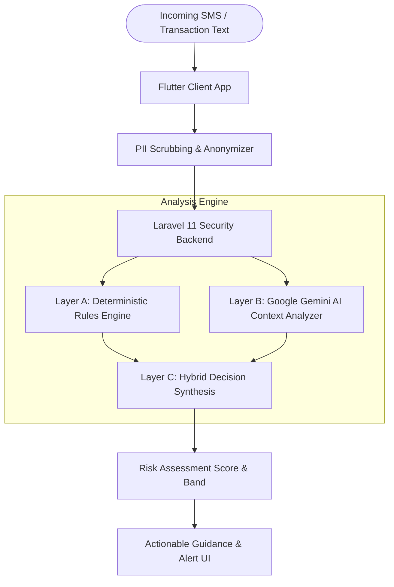

# 🛡️ Munda AI Fraud Shield — FinTech Security Platform

[](https://flutter.dev/)
[](https://laravel.com/)
[](https://ai.google.dev/)
[](https://www.php.net/)
[](LICENSE)

**Munda AI Fraud Shield** is an advanced, privacy-first FinTech fraud detection and threat intelligence platform designed to protect consumers and financial institutions across Zambia and emerging African mobile money ecosystems (Airtel Money, MTN MoMo, ZANACO, ABSA, ZRA, ZESCO).

Combining a deterministic rules engine with Google Gemini contextual AI and client-side PII scrubbing, Munda AI detects SMS scams, fake mobile money reversals, credential harvesting, and phishing in real time.

---

## 🌟 Key Features

### 1. 🔍 Hybrid Multi-Tier Threat Analysis
- **Layer A (Deterministic Rules Engine)**: Instant heuristic scanning for known predatory patterns (fake MoMo transaction IDs, spoofed reverse transfers, urgency tactics, impersonation keywords).
- **Layer B (PII Redaction Engine)**: Automatic zero-knowledge scrubbing of phone numbers, names, bank account numbers, and NRC IDs *before* any text leaves the device or hits external LLM APIs (complying with the **Zambia Data Protection Act No. 3 of 2021**).
- **Layer C (Google Gemini AI Analysis)**: Contextual semantic reasoning evaluating subtle linguistic manipulation, psychological pressure, and deceptive URL redirects.
- **Layer D (Decision Synthesis)**: Triangulated risk score (0–100%), calibrated risk band (`SAFE`, `SUSPICIOUS`, `HIGH_RISK`), verified indicators, and step-by-step actionable safety advice.

### 2. 🤖 Gemini AI Security Assistant
- Real-time conversational security guide specialized in Zambian financial fraud.
- Explains suspicious alerts in clear, plain language.
- Built-in sound synthesis and audio guidance.
- Guardrails ensuring focused, high-integrity financial protection advice.

### 3. 🎨 Executive FinTech User Interface
- Dark theme inspired by modern banking applications with midnight ocean navy accents, true obsidian charcoal surfaces, and vibrant status indicators.
- Live animated **AI Shield Orb** with real-time analysis pulsing.
- Interactive **Synthetic Threat Scenarios** allowing one-tap simulation of real-world attack vectors (e.g. Airtel Fake Refund, MTN Prize Scam, ZANACO OTP Theft, ABSA Account Block).
- Comprehensive scan history, detailed risk breakdowns, and zero-knowledge privacy audit trails.

### 4. 🔐 Security & Access Control
- 4-digit biometric & PIN lock protection.
- Non-custodial architecture: user credentials and plain-text sensitive PII are never permanently persisted.
- Rate-limited API security endpoints.

---

## 🏗️ Architecture & Data Flow



---

## 💻 Tech Stack

| Component | Technology | Description |
| :--- | :--- | :--- |
| **Frontend** | [Flutter](https://flutter.dev/) (Dart 3.x) | Cross-platform web & mobile application |
| **Design System** | Vanilla Material 3 + Google Fonts | Sber-inspired midnight navy & charcoal dark theme |
| **Backend API** | [Laravel 11](https://laravel.com/) (PHP 8.2+) | Modular security service & rules engine |
| **AI Intelligence**| [Google Gemini API](https://ai.google.dev/) | Contextual semantic threat evaluation |
| **Typography** | Inter & Outfit | Google Fonts for financial clarity |
| **Compliance** | Zambia Data Protection Act (2021) | Zero-Knowledge PII Redaction layer |

---

## 📂 Project Structure

```text
finTech/
├── backend/                       # Laravel 11 REST API
│   ├── app/
│   │   ├── Http/Controllers/Api/  # FraudAnalysisController & AssistantController
│   │   ├── Services/
│   │   │   ├── AI/                # GeminiService integration
│   │   │   ├── FraudDetection/    # Deterministic Rules Engine
│   │   │   └── Security/          # PII Anonymizer Service
│   ├── routes/api.php             # Protected & throttled API routes
│   └── tests/                     # Automated PHPUnit & Feature tests
│
├── frontend/                      # Flutter Web & Mobile Application
│   ├── lib/
│   │   ├── data/                  # Synthetic threat test cases & samples
│   │   ├── models/                # AnalysisResult, RiskBand, SampleMessage
│   │   ├── screens/               # HomeScreen, AnalyzerScreen, AssistantScreen, etc.
│   │   ├── services/              # FraudService, AssistantService, AuthService
│   │   ├── theme/                 # AppTheme (colors, typography, light/dark themes)
│   │   └── widgets/               # AiShieldOrb, AppBottomNav, HomeTopNav, etc.
│   └── test/                      # Flutter widget & unit test suites
│
└── README.md                      # Project documentation
```

---

## 🚀 Getting Started

### Prerequisites
- **Flutter SDK** (v3.13+ / 3.47+)
- **PHP** (8.2 or higher)
- **Composer** (v2.x)
- **Google Gemini API Key** (optional for AI analysis; rule engine functions independently in demo mode)

---

### Backend Setup (Laravel)

1. Open a terminal and navigate to the backend directory:
   ```bash
   cd backend
   ```

2. Install PHP dependencies:
   ```bash
   composer install
   ```

3. Configure your environment file:
   ```bash
   cp .env.example .env
   php artisan key:generate
   ```

4. Set your Gemini API key in `backend/.env` (optional):
   ```env
   GEMINI_API_KEY=your_gemini_api_key_here
   ```

5. Run database migrations:
   ```bash
   php artisan migrate
   ```

6. Start the backend development server:
   ```bash
   php artisan serve
   ```
   *The API will be available at `http://127.0.0.1:8000`.*

---

### Frontend Setup (Flutter)

1. Open a second terminal and navigate to the frontend directory:
   ```bash
   cd frontend
   ```

2. Fetch Flutter packages:
   ```bash
   flutter pub get
   ```

3. Run code analysis to verify health:
   ```bash
   flutter analyze
   ```

4. Launch the application:
   - **Chrome (Web)**:
     ```bash
     flutter run -d chrome
     ```
   - **Android / iOS Device**:
     ```bash
     flutter run
     ```

---

## 🧪 Testing

### Running Frontend Tests
```bash
cd frontend
flutter test
```
*Executes unit and widget tests covering PIN authentication, SMS analysis verification, and UI components.*

### Running Backend Tests
```bash
cd backend
php artisan test
```
*Validates the deterministic rules engine, PII anonymizer, rate limiters, and API responses.*

---

## 📡 Core API Endpoints

### 1. Analyze SMS Message
```http
POST /api/v1/analyze-sms
Content-Type: application/json

{
  "message": "Dear Customer, your bank account has been blocked. Call +260971234567 immediately to unlock."
}
```

**Response Example:**
```json
{
  "risk_score": 92,
  "risk_band": "HIGH_RISK",
  "threat_category": "Phishing & Account Impersonation",
  "explanation": "High-risk alert detected. This message uses psychological urgency and unauthorized contact details to harvest authentication credentials.",
  "indicators": [
    "Threat of immediate account suspension",
    "Unverified third-party phone number",
    "Absence of official institution verification headers"
  ],
  "recommended_action": "Do NOT reply or call the number. Contact your financial institution directly through official customer service channels.",
  "privacy_protection": {
    "pii_redacted": true,
    "redacted_elements_count": 1,
    "detected_types": ["phone_number"]
  }
}
```

### 2. Assistant Interactive Chat
```http
POST /api/v1/assistant/chat
Content-Type: application/json

{
  "message": "Someone sent me money by mistake and wants me to send it back via a different number. Is this safe?"
}
```

### 3. Service Health Check
```http
GET /api/health
```

---

## 🔒 Privacy & Regulatory Compliance

Munda AI Fraud Shield strictly complies with the **Zambia Data Protection Act No. 3 of 2021**:
- **Zero-Storage of Raw PII**: Customer phone numbers, PINs, OTP codes, NRC numbers, and bank account digits are redacted via client and server scrubbing before evaluation.
- **Transparent Explainability**: Every assessment provides clear rationales so users understand *why* a message is classified as dangerous.
- **Independent Evaluation Disclaimer**: Munda AI is an independent FinTech security solution developed for research, evaluation, and user protection in Zambia.

---

## 📄 License

This project is licensed under the MIT License — see the [LICENSE](LICENSE) file for details.
